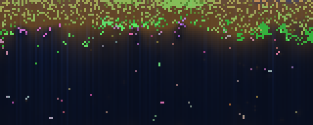
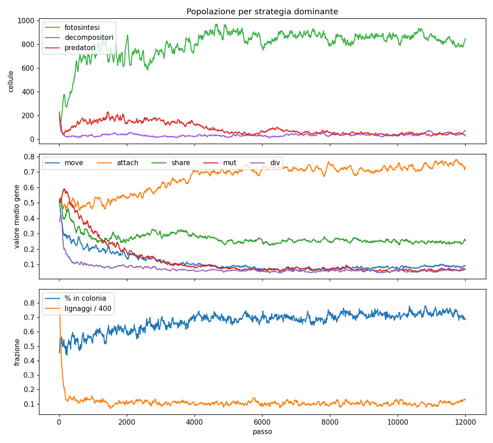

# WorldSim

Artificial-life simulation: cells with a genome live, feed, reproduce and evolve in a 2D world. **No explicit fitness**: whatever manages to get energy and reproduce survives.

Public, open-source, non-commercial — built for fun and curiosity.

Documentation starts at [`docs/INDEX.md`](docs/INDEX.md):
- Field survey: [`docs/state-of-the-art.md`](docs/state-of-the-art.md)
- v0 design: [`docs/design-v0.md`](docs/design-v0.md)
- Theory (why this is not a genetic algorithm): [`docs/theory.md`](docs/theory.md)
- Roadmap (simulation + game): [`docs/ROADMAP.md`](docs/ROADMAP.md)
- Contributing: [`docs/DEVELOPER_GUIDE.md`](docs/DEVELOPER_GUIDE.md)

## Quick start

```bash
./scripts/bootstrap-dev.sh        # or .\scripts\bootstrap-dev.ps1 on Windows — once per clone

# interactive viewer
python view.py

# headless run: CSV, PNG snapshots, plot
python run.py --steps 10000 --seed 1 --out runs/test1

# override a parameter on the fly
python run.py --steps 5000 --out runs/test2 --set pred_eff=0.7 --set immigration_rate=0
```

Viewer keys: `SPACE` pause · `N` one step · `+/-` speed · `O` organic matter · `S` snapshot · `R` new world · click = inspect a cell.

**Colors**: green = photosynthesis · purple = decomposers · red = predators (mixes give intermediate colors, e.g. yellow = plant-predator). Blue background shows light, brown shows organic matter.

## How it works

It is not a classic genetic algorithm (fitness → selection → crossover). It is **implicit natural selection**:

1. Each cell has a **genome** of 9 numbers in [0,1] (photosynthesis, decomposition, predation, movement, division threshold, energy given to the child, tendency to stay attached, sharing, mutation rate).
2. Each step it pays a **metabolic cost** and gains energy according to its genes and the environment (light, organic matter, neighbors to eat).
3. With enough energy it **divides**: the child inherits the genome with **Gaussian mutations**. At zero energy or maximum age it **dies** and becomes organic matter.
4. The genes of whoever reproduces most spread. That's it.

The only energy source is light, which fades with depth and is shaded by the cells above.

## Structure

```
worldsim/
  config.py   parameters (everything tunable)
  world.py    engine: grid, cells, step cycle, statistics
  render.py   world -> RGB image
run.py        headless run + CSV + plot
view.py       pygame viewer
tests/        pytest suite (engine invariants)
docs/         research, design, governance
runs/         run outputs (git-ignored)
```

## v0 results (seeds 1 and 7, 8–12k steps)





- Stable ecosystem, no extinctions, ~900 cells.
- The three strategies coexist, stratified: plants and plant-predator hybrids at the surface, plants below them, decomposers further down where organic matter settles.
- They evolve on their own: **colonies** (`attach` 0.5 → 0.73, ~70% of cells bonded), falling **mutation rate**, **movement** abandoned, early division.

## Next steps

See [`docs/ROADMAP.md`](docs/ROADMAP.md).
