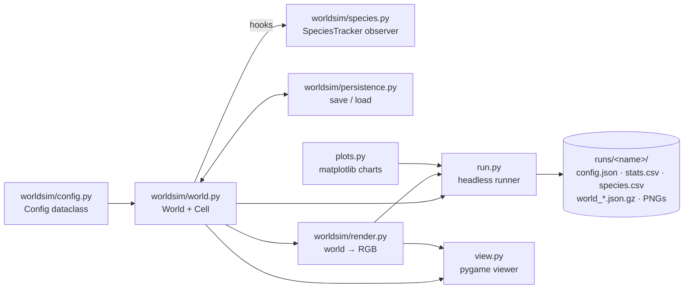

# Architecture

Last updated: 2026-11-10

## Overview

A single-process Python application. The engine (`worldsim/`) is headless and
depends only on numpy (Pillow for rendering). Two front-ends drive it: `run.py`
for batch experiments and `view.py` for interactive observation; `plots.py`
(matplotlib) lives outside the engine.

## Modules

### `worldsim/config.py`
`Config` dataclass holding every tunable parameter (world size, light, organic
matter, metabolism, nutrition, reproduction, mutation, immigration). `run.py
--set KEY=VALUE` overrides any field; the full config is saved with each run.

### `worldsim/world.py`
- **Grid**: flat list `grid[y * W + x]` of `Cell | None`. x is toroidal; y is
  depth (row 0 = lit surface, last row = seabed, closed edges).
- **Fields** (numpy `(H, W)`): `light` = depth attenuation × `shade` per cell
  above; `organic` = diffusing, sinking, decaying organic matter.
- **Cell**: `__slots__` object with a 9-gene genome (`photo`, `sapro`, `pred`,
  `move`, `div`, `child`, `attach`, `share`, `mut`). `express()` derives the
  phenotype once at birth.
- **Bonds**: colonies are symmetric `bonds` links between cells, created at
  division with probability `attach`, cleared on death. Stored as an
  insertion-ordered `dict` used as an ordered set: energy sharing iterates it,
  so its order is simulation state (ADR-0002).
- **`stats()`**: one dict per sample → one `stats.csv` row (plus species
  columns when tracking is on).
- **Hooks**: `seed_population`, immigration, division and `kill()` notify the
  optional `tracker`; `now` is the step being executed.

### `worldsim/species.py`
`SpeciesTracker`, a pure observer (ADR-0003): threshold speciation on founder
genomes, species tree with pruning of failed lineages, simplified evolutionary
activity and the novelty counter. Never touches the RNG; the dynamics never read it.

### `worldsim/persistence.py`
`save_world` / `load_world`: gzip JSON, versioned, validated on load (ADR-0002).
Resume is bit-exact.

### `worldsim/render.py`
Maps the world to an RGB array: cell color mixes green/purple/red by
photo/sapro/pred share; background shows light (blue) and organic matter (brown).

### `run.py` and `plots.py`
Headless loop: steps, CSV sampling, periodic PNG snapshots and saves
(`--save-every`), `--resume`, final save, `species.csv`, and charts:
`stats.png`, `species_tree.png`, `novelty.png` (`plots.py` reads CSV columns by name).

### `view.py`
pygame viewer: pause, single step, speed, organic overlay, snapshot, new world,
click-to-inspect a cell; `--load` opens a save file.

## Data flows

### One simulation step (`World.step()`)
1. Recompute `light` from current occupancy.
2. Shuffle cells; for each living cell: age → upkeep → photosynthesis /
   decomposition → predation (random unbonded neighbor) → movement (unbonded
   cells only) → energy sharing with bonded cells → death check → division
   (mutated child, optional bond).
3. Drop dead cells, append newborns, update `organic` (diffuse, sink, decay).
4. Immigration of random cells; reseed on total extinction.

### Energy
The only external input is light. Energy leaves cells as upkeep and movement
cost; on death, `decomp_fraction × (energy + body_cost)` becomes organic matter;
predation splits the prey's energy + body between predator and organic matter.

### Experiment
`run.py --seed S --set ...` → `runs/<name>/config.json` (reproducibility record)
+ `stats.csv` + snapshots + saves + charts. Any save can be resumed
(`run.py --resume`) or opened in the viewer (`view.py --load`).

## Cross-cutting concerns

- **Determinism**: all randomness must go through `World.rng`
  (`random.Random(seed)`), and no iteration order may depend on memory
  addresses — `Cell.__hash__` returns the deterministic cell `id` so `bonds`
  sets iterate identically across runs. Same seed → byte-identical `stats.csv`.
- **Performance** (2026-11-10, cProfile, ~800 cells): ~540 steps/s with species
  tracking, ~560 without. Time split: `step()` body ~30%, `neighbors()` +
  `random_empty_neighbor()` ~17%, `rng.shuffle` ~11%, Gaussian mutation ~12%,
  `update_light` ~8%. Cheapest next win: a precomputed neighbor-index table
  (same iteration order, so determinism is unaffected).
- **Invariants** (covered by `tests/`): grid ↔ cell list consistency (every
  step), bond symmetry, gene bounds, non-negative organic matter, energy
  conservation in a closed system, bit-exact resume, tracker purity.
- No network, no secrets. Save files are JSON, never pickle (safe to share).

## Decisions
See [`adr/`](./adr/) — decisions are recorded there, not here.
