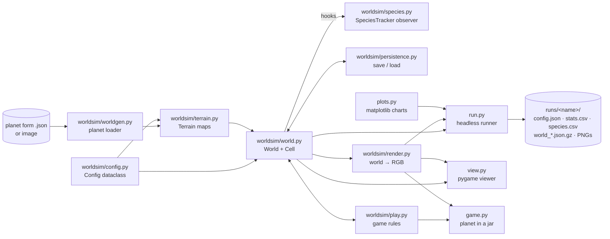

# Architecture

Last updated: 2026-11-10 (F2)

## Overview

A single-process Python application. The engine (`worldsim/`) is headless and
depends only on numpy (Pillow for rendering). Two front-ends drive it: `run.py`
for batch experiments and `view.py` for interactive observation; `plots.py`
(matplotlib) lives outside the engine.

## Modules

### `worldsim/config.py`
`Config` dataclass holding every tunable parameter (world size, light, organic
matter, metabolism, nutrition, reproduction, mutation, immigration). `run.py
--set KEY=VALUE` overrides any field; the full config is saved with each run.

### `worldsim/terrain.py`
`Terrain`: static maps — `rock` (cells cannot occupy it; opaque to light),
`chem` (chemical energy per step, from vents), `sun` (surface light per column),
`organic` (initial organic matter). `generate_terrain` builds seabed ridges and
vents from `Config` with its own seed-derived RNG (ADR-0004); defaults are flat.

### `worldsim/worldgen.py`
World seed from untrusted input: a JSON planet form (star, day/night,
seasonality, ocean depth, relief, volcanism, minerals, raw `Config` overrides)
or an image (column brightness → sun, red → chem, blue → organic, edges → rock,
SHA-256 of the bytes → seed). Size caps and field validation; errors are `PlanetError`.

### `worldsim/world.py`
- **Grid**: flat list `grid[y * W + x]` of `Cell | None`. x is toroidal; y is
  depth (row 0 = lit surface, last row = seabed, closed edges). `blocked[i]`
  marks rock tiles; every placement path checks it.
- **Fields** (numpy `(H, W)`): `light` = `base_light` (depth × sun × rock shadow)
  × `shade` per cell above × `light_factor(t)` (day/night × season, a pure
  function of the step); `organic` = diffusing, sinking, decaying organic matter;
  `chem` = static chemical energy.
- **Cell**: `__slots__` object with a 16-gene genome (`photo`, `sapro`, `pred`,
  `move`, `div`, `child`, `attach`, `share`, `mut`, `chemo`, then the F3 sensor
  weights `w_light`, `w_organic`, `w_chem`, `w_kin`, `w_stranger`, `w_danger`).
  `express()` derives the phenotype once at birth; the four feeding genes are
  normalised shares, sensor genes become signed weights `2g − 1` (`Cell.sense`).
- **Sensing (F3)**: with `Config.sensing`, `sensed_move()` scores staying put and
  each free neighbour tile (light, organic, chemical energy, kin/stranger/danger
  densities, radius 1) and moves to the best; otherwise movement is a random walk
  (ADR-0005).
- **Open genome (F4)**: with `Config.open_genome`, a cell also carries `rules`, a
  variable-length list of rule genes `(condition, threshold, target, intensity)`.
  `rule_effects()` applies the active ones once per cell per step (extra sensor weight,
  or a shifted division threshold); `mutate_rules()` mutates, duplicates, deletes and
  adds rules at division. Off by default with no RNG draws; species ignore rules (ADR-0006).
- **Two parents (F5a)**: with `Config.sex`, each cell has an evolvable `sex_p`; at division
  `find_mate()` picks a genetically close cell within `mate_radius` and `offspring_genes()`
  does a uniform crossover before mutation. Lineage and species follow the dividing parent.
  Off by default with no RNG draws (ADR-0007).
- **Plasticity (F5b)**: with `Config.plasticity`, each cell has an evolvable acclimation rate
  `plast_p` and an acclimated `diet` (photo/sapro/chemo split of the non-predatory share).
  `acclimate()` moves the diet each step, before feeding, towards what each diet would yield
  on the tile; `apply_diet()` re-derives the shares. No RNG in the update; the diet restarts
  from the genes at birth. Off by default with no RNG draws (ADR-0009).
- **Bonds**: colonies are symmetric `bonds` links between cells, created at
  division with probability `attach`, cleared on death. Stored as an
  insertion-ordered `dict` used as an ordered set: energy sharing iterates it,
  so its order is simulation state (ADR-0002).
- **`stats()`**: one dict per sample → one `stats.csv` row (plus species
  columns when tracking is on).
- **Hooks**: `seed_population`, immigration, division and `kill()` notify the
  optional `tracker`; `now` is the step being executed.

### `worldsim/species.py`
`SpeciesTracker`, a pure observer (ADR-0003): threshold speciation on founder
genomes, species tree with pruning of failed lineages, simplified evolutionary
activity and the novelty counter. Never touches the RNG; the dynamics never read it.

### `worldsim/persistence.py`
`save_world` / `load_world`: gzip JSON, versioned, validated on load (ADR-0002;
v2 adds the terrain maps, ADR-0004; v3 the 16-gene genome, ADR-0005; v4 the rule genes, ADR-0006; v5 the mating propensity, ADR-0007; v6 the diet plasticity, ADR-0009). Resume is bit-exact.

### `worldsim/render.py`
Maps the world to an RGB array: cell color mixes green/purple/red/cyan by
photo/sapro/pred/chemo share; background shows light (blue), organic matter
(brown), chemical energy (orange glow) and rock (grey).

### `run.py` and `plots.py`
Headless loop: steps, CSV sampling, periodic PNG snapshots and saves
(`--save-every`), `--resume`, final save, `species.csv`, and charts:
`stats.png`, `species_tree.png`, `novelty.png` (`plots.py` reads CSV columns by name).

### `worldsim/play.py` (G1)
Game rules, headless: interventions (`add_nutrients`, `meteorite`, `raise_rock`,
`dig`, `add_vent`) are instant, RNG-free edits of saved state applied between
steps (terrain edits rebuild derived maps via `set_terrain`); `Game` adds the
divine-energy budget, an action log (`replay` reproduces a game) and five
milestones checked every `check_every` steps. `GameRules` holds costs and
thresholds; it never changes the simulation itself.

### `game.py`
pygame front-end of `Game`: tool selection, click/drag to act, budget bar,
milestone list, toasts, colour key. Reuses `view.add_world_args/create_world`.

### `view.py`
pygame viewer: pause, single step, speed, organic overlay, snapshot, new world
(same terrain), click-to-inspect a cell; `--load` opens a save file, `--planet`
a planet form or image.

## Data flows

### One simulation step (`World.step()`)
1. Recompute `light` from current occupancy and the day/season factor.
2. Shuffle cells; for each living cell: age → upkeep → photosynthesis /
   decomposition / chemosynthesis → predation (random unbonded neighbor) → movement (unbonded
   cells only; sensed when `sensing` is on) → energy sharing with bonded cells → death check → division
   (mutated child, optional bond).
3. Drop dead cells, append newborns, update `organic` (diffuse, sink, decay).
4. Immigration of random cells; reseed on total extinction.

### Energy
The external inputs are light and, where vents exist, chemical energy (both
unlimited per tile, limited by space and shading). Energy leaves cells as upkeep and movement
cost; on death, `decomp_fraction × (energy + body_cost)` becomes organic matter;
predation splits the prey's energy + body between predator and organic matter.

### Experiment
`run.py --seed S --set ...` → `runs/<name>/config.json` (reproducibility record)
+ `stats.csv` + snapshots + saves + charts. Any save can be resumed
(`run.py --resume`) or opened in the viewer (`view.py --load`).

## Cross-cutting concerns

- **Determinism**: all randomness must go through `World.rng`
  (`random.Random(seed)`), and no iteration order may depend on memory
  addresses — `Cell.__hash__` returns the deterministic cell `id` so `bonds`
  sets iterate identically across runs. Same seed → byte-identical `stats.csv`.
- **Performance**: F3 sensing costs ~30% (≈ 545 → 380 steps/s, seed 1, 3k steps); it is
  computed only for cells that pass the movement gate. F2 adds no measurable cost on a flat world (back-to-back on
  the same machine: F1 303 vs F2 354 steps/s, seed 1, 3k steps; absolute numbers
  vary ±40% with machine load, so compare runs back-to-back). Rocks add one
  lookup per neighbour check. F1 profile (cProfile, ~800 cells): ~540 steps/s with species
  tracking, ~560 without. Time split: `step()` body ~30%, `neighbors()` +
  `random_empty_neighbor()` ~17%, `rng.shuffle` ~11%, Gaussian mutation ~12%,
  `update_light` ~8%. Cheapest next win: a precomputed neighbor-index table
  (same iteration order, so determinism is unaffected).
- **Invariants** (covered by `tests/`): grid ↔ cell list consistency (every
  step), bond symmetry, gene bounds, non-negative organic matter, energy
  conservation in a closed system, bit-exact resume (also mid day/season and with
  terrain), tracker purity, no cell ever on rock.
- No network, no secrets. Save files are JSON, never pickle (safe to share).
  Planet forms, images and saves are untrusted input: bounded and validated.

## Decisions
See [`adr/`](./adr/) — decisions are recorded there, not here.
