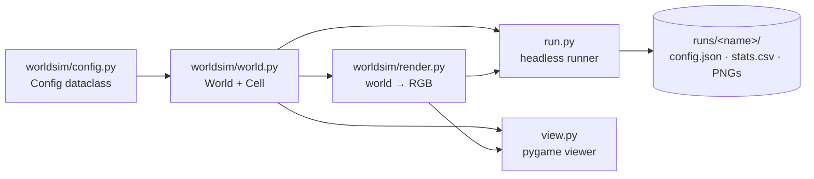

# Architecture

Last updated: 2026-11-10

## Overview

A single-process Python application. The engine (`worldsim/`) is headless and
depends only on numpy (Pillow for rendering). Two front-ends drive it: `run.py`
for batch experiments and `view.py` for interactive observation.

## Modules

### `worldsim/config.py`
`Config` dataclass holding every tunable parameter (world size, light, organic
matter, metabolism, nutrition, reproduction, mutation, immigration). `run.py
--set KEY=VALUE` overrides any field; the full config is saved with each run.

### `worldsim/world.py`
- **Grid**: flat list `grid[y * W + x]` of `Cell | None`. x is toroidal; y is
  depth (row 0 = lit surface, last row = seabed, closed edges).
- **Fields** (numpy `(H, W)`): `light` = depth attenuation × `shade` per cell
  above; `organic` = diffusing, sinking, decaying organic matter.
- **Cell**: `__slots__` object with a 9-gene genome (`photo`, `sapro`, `pred`,
  `move`, `div`, `child`, `attach`, `share`, `mut`). `express()` derives the
  phenotype once at birth.
- **Bonds**: colonies are symmetric `bonds` sets between cells, created at
  division with probability `attach`, cleared on death.
- **`stats()`**: one dict per sample → one `stats.csv` row.

### `worldsim/render.py`
Maps the world to an RGB array: cell color mixes green/purple/red by
photo/sapro/pred share; background shows light (blue) and organic matter (brown).

### `run.py`
Headless loop: steps, CSV sampling, periodic PNG snapshots, final matplotlib
plot (`plot_stats` reads CSV columns by name).

### `view.py`
pygame viewer: pause, single step, speed, organic overlay, snapshot, new world,
click-to-inspect a cell.

## Data flows

### One simulation step (`World.step()`)
1. Recompute `light` from current occupancy.
2. Shuffle cells; for each living cell: age → upkeep → photosynthesis /
   decomposition → predation (random unbonded neighbor) → movement (unbonded
   cells only) → energy sharing with bonded cells → death check → division
   (mutated child, optional bond).
3. Drop dead cells, append newborns, update `organic` (diffuse, sink, decay).
4. Immigration of random cells; reseed on total extinction.

### Energy
The only external input is light. Energy leaves cells as upkeep and movement
cost; on death, `decomp_fraction × (energy + body_cost)` becomes organic matter;
predation splits the prey's energy + body between predator and organic matter.

### Experiment
`run.py --seed S --set ...` → `runs/<name>/config.json` (reproducibility record)
+ `stats.csv` + snapshots + `stats.png`.

## Cross-cutting concerns

- **Determinism**: all randomness must go through `World.rng`
  (`random.Random(seed)`), and no iteration order may depend on memory
  addresses — `Cell.__hash__` returns the deterministic cell `id` so `bonds`
  sets iterate identically across runs. Same seed → byte-identical `stats.csv`.
- **Performance**: ~500 steps/s with ~900 cells; the per-cell loop is the hot
  path. Fields are vectorized with numpy.
- **Invariants** (covered by `tests/`): grid ↔ cell list consistency, bond
  symmetry, gene bounds, non-negative organic matter.
- No network, no persistence beyond run outputs, no secrets.

## Decisions
See [`adr/`](./adr/) — decisions are recorded there, not here.
