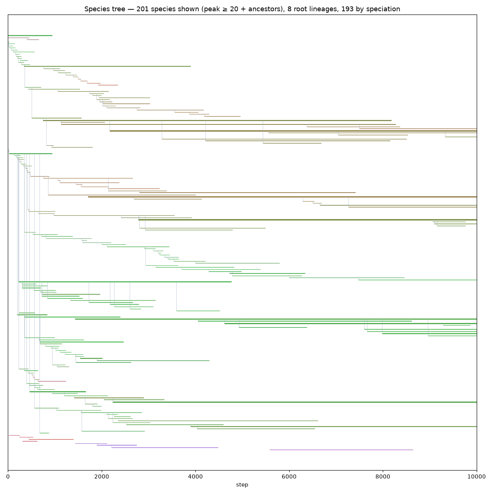
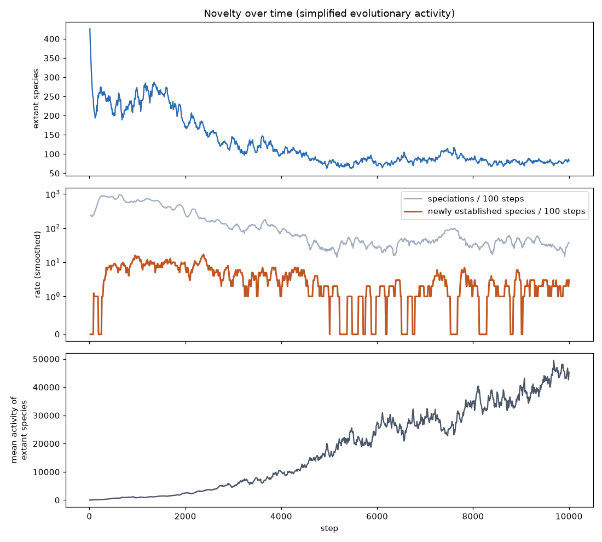
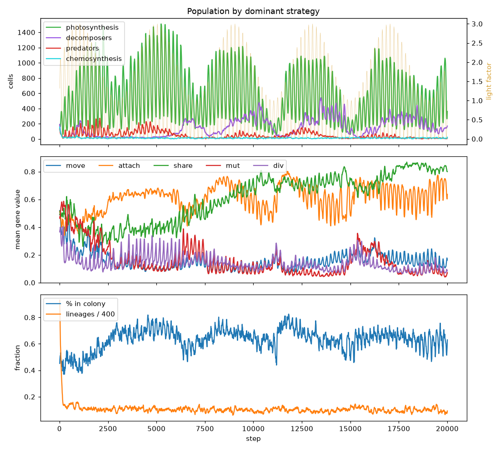
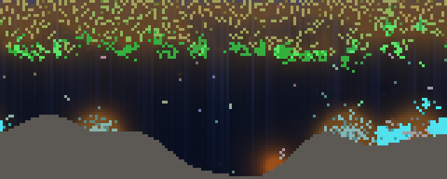
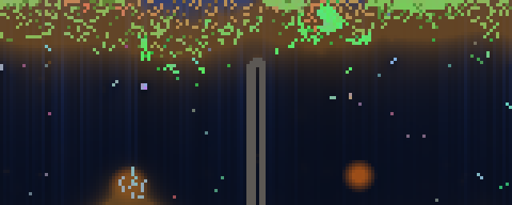

# WorldSim — Roadmap

Last updated: 2026-11-10

> How to grow WorldSim from a "cell ecosystem" into something open-ended, and possibly into a game.
> Guiding rule: **one new mechanism at a time**, each with an experiment that tells whether it worked. The order of phases 3–7 is flexible.

## Overview

```
SIMULATION (lab, Python)                          GAME (product)
F1 Foundations ──► F2 Living environment + world seed ──► G1 "Planet in a jar" prototype
                   F3 Sensors and behavior                 G2 Engine port (C#/Burst or Rust)
                   F4 Open genome                          G3 Goals, progression, UI
                   F5 Two parents and plasticity
                   F6 True multicellularity
                   F7 Signals → social
```

---

## v0 — Base engine
**Status**: done (2026-11). Cells with a 9-gene genome (16 since F3), energy, light, organic matter, colonies; headless runner and pygame viewer. See [design-v0.md](design-v0.md).

## F1 — Foundations (before adding biology)
**Status**: done (2026-11-10). Determinism per seed, bit-exact save/resume ([ADR-0002](adr/0002-save-format.md)), species tracking and simplified evolutionary activity ([ADR-0003](adr/0003-species-definition.md)), energy-conservation and invariant tests, profiling (~540 steps/s at ~800 cells, see ARCHITECTURE).

**Result** (seed 1, 10k steps, `python run.py --steps 10000 --seed 1 --save-every 5000`): resuming from step 5000 in a separate process reproduces the straight run exactly. Novelty is high for ~2500 steps (~10 newly established species / 100 steps), then drops roughly tenfold after step ~4500, while extant species settle around 80 and mean species activity keeps rising: **the v0 system stabilizes** — the signal the F4 criterion looks for. Two engine bugs were found on the way (id-based set ordering broke determinism; newborns eaten at birth stayed as ghosts).





Without these tools you cannot tell what is going on as the system grows.
- **Saving/loading** the world and **determinism** (same seed → same history).
- **Species tracking**: genome clustering + phylogenetic tree (who descends from whom).
- **Novelty metrics** (Bedau activity statistics) to measure whether the system is still inventing or has stalled.
- Regression tests (energy conservation, no duplicated cells in the grid).
- Profiling: currently ~500 steps/s with ~900 cells. Practical Python limit ≈ a few thousand cells.

**Exit criterion**: I can re-run a simulation, see its species tree and a "novelty over time" chart.

## F2 — Living environment + world seed
**Status**: done (2026-11-10). Light cycles, rocky seabed, hydrothermal vents with a 10th gene `chemo` (chemosynthesis), and a world generated from a planet form or an image ([ADR-0004](adr/0004-terrain-and-save-v2.md)). All off by default: the default `Config` is still the flat v0 world, but adding the gene changed every seed's history, so F1 numbers reproduce only at the F1 commit.

**Experiment A — variable light** (seeds 1 and 7, 20k steps, `--set day_amplitude=1 --set season_amplitude=0.5` vs constant light; repeated with `--set immigration_rate=0` as a control; means over steps 16–20k):

| Pair | mean `mut` const → var | `div` (reserves) const → var | novelty, steps 10–20k |
|---|---|---|---|
| seed 1 | 0.057 → 0.116 | 0.047 → 0.199 | 132 → 217 |
| seed 7 | 0.045 → 0.117 | 0.046 → 0.099 | 123 → 172 |
| seed 1, no immigration | 0.028 → 0.038 | 0.025 → 0.120 | 117 → 162 |
| seed 7, no immigration | 0.027 → 0.159 | 0.029 → 0.065 | 94 → 217 |

- **Mutation rate stays higher** in a variable environment in 4/4 pairs, but weakly once confounds are removed: nightly population crashes let random immigrants (mean `mut` 0.5) weigh more, and within established lineages (≥ 20 cells) the gap at step 20k is small and inconsistent (0.036 → 0.050, 0.029 → 0.026, 0.021 → 0.025, 0.028 → 0.050). Answer: *partly, not robustly*.
- **Reserves arise** (the clearest effect, 4/4): cells divide at a much higher energy threshold, i.e. they store energy to survive the night. No spores yet (there is no dormancy mechanism to evolve).
- **More novelty** in 4/4 pairs; the population oscillates daily (≈ 200–1400 cells) with no extinctions.

**Experiment B — vents** (seeds 1 and 7, 20k steps, `--set rock_fraction=0.2 --set vent_count=4`):
with `vent_strength=1` chemosynthetic colonies appear (up to 54 cells) but never last; with `vent_strength=2, vent_radius=4` (now the defaults) a stable chemosynthetic niche of 100–280 cells holds in the dark at the vents on both seeds — a threshold effect. Novelty rises (seed 1: 517 flat → 754).

**World seed**: `run.py --planet examples/volcanic.json` (form) or `--planet photo.png` (image: column brightness → sunlight, red → minerals/vents, blue → nutrients, edges → rock walls, SHA-256 → seed). Inputs are untrusted and validated (security review 2026-11-10).



 

Open: alternative chemistries (silicon/ammonia presets) and catastrophes from the form are deferred to G1, where they become player verbs.

Original scope:
- Day/night cycle and **seasons** (variable light).
- Heterogeneous terrain: rocks, mineral-rich zones, hydrothermal vents (chemical energy, not just light).
- **World generated from an input** (photo or form, see the dedicated section).
- Experiment: in a variable environment, does the mutation rate rise again? Do seasonal strategies (spores, reserves) arise?

## F3 — Sensors and behavior
**Status**: done (2026-11-10). Six sensor genes (weights for light, organic matter, chemical energy, kin, strangers, danger) steer movement when `--set sensing=1` ([ADR-0005](adr/0005-sensor-genes-and-save-v3.md)). Off by default; the genes are always present (16-gene genome) and inert when sensing is off, which gives a neutral-drift control arm. Sensing costs ~30% of the speed (≈ 545 → 380 steps/s, seed 1, 3000 steps).

**Experiment** (`python scripts/f3_experiment.py --steps 10000`, results in [f3_experiment.csv](f3_experiment.csv)): sensing on/off × flat default world and `examples/volcanic.json` × seeds 1, 7 × immigration 0.5 / 0; measured over steps 5–10k on motile unbonded **descendants** (`move` > 0.3; seeded founders and immigrants excluded, since a light-seeking immigrant would bias the sample without any inheritance). Means below use only arms with ≥ 10 motile descendants on average (5 off, 7 on); the 4 small arms (no immigration, 2.8–8.9 motile cells) are in the CSV. Measured after the F3 code review fixed the social inputs (edge rows, kin predators); the sensing-off arms match the pre-fix run on every reported column, as they should.

| Question | Sensing off (5 arms) | Sensing on (7 arms) | Verdict |
|---|---|---|---|
| Phototaxis, immigration arms only (535–766 motile lineages each): mean `w_light` | −0.16 (1/4 positive) | +0.26 (3/4 positive; +0.36, +0.52, +0.18, −0.01) | likely selected; modest effect, 2 seeds |
| Phototaxis, all arms with enough motile cells | −0.27 (1/5 positive) | +0.41 (6/7 positive) | founder-dominated arms inflate this |
| Fleeing: mean `w_danger` | −0.25 (3/5 negative, by drift) | +0.07 (3/7 negative) | no |
| Hunting: kills per predator-step (median) | 0.65 | 0.63 | no |
| Fleeing (prey side): kills per prey-step | 0.051 | 0.050 | no |
| Vertical migration (volcanic, day/night): corr(light factor, mean depth of motile plants) | −0.03 to −0.10 (3 arms) | −0.05 to −0.26 (4 arms; 2 clearly negative) | weak and inconsistent |

- **Phototaxis is likely selected, with a modest effect.** The clean evidence is the 4 immigration arms, where hundreds of lineages move: +0.26 on average with sensing vs −0.16 without. The no-immigration arms (1–5 lineages supply all motile cells) are founder lotteries: drift alone reaches ±0.7 there, and the small flat seed-1 arm with sensing ended at −0.74. Before the review fixes the same 4 arms gave +0.30 to +0.56, so the effect shrank. More seeds are needed to call it robust.
- **Day/night depth rhythm**: weak and inconsistent. Where it shows (seed 1: plants slightly shallower in daylight) it is most simply a by-product of phototaxis, whose pull weakens at night when the light gradient falls below the sensing noise; not tested as a separately evolved trait.
- **No fleeing or hunting.** Expected for hunting: predation strikes any adjacent cell and perception has radius 1, so moving buys a predator little. Other weights (organic, chemical, kin, strangers) wander in both arms: founder effects are large, especially without immigration, where 1–5 lineages supply all motile cells.
- The control arm is not perfectly neutral (ADR-0005): a sensing cell may choose to stay, and every cell pays `sense_upkeep`.
- Speciation stays comparable after the per-gene distance rescaling: with immigration, 77–93 species and 299–435 established novelties at 10k steps with sensing off and 67–113 / 220–490 with sensing on, vs 72–107 and 359–587 before F3 (same planets and seeds). Comparable in order of magnitude only: the sensor genes add neutral drift to the distance (ADR-0005).
- Next: a wider perception radius, or a cost on staying near predators, are separate experiments (one mechanism at a time).

Original scope:
- The cell perceives its 8 neighboring tiles: light, organic matter, presence of cells, kinship.
- **Directed** movement (towards food/light, away from predators) instead of random.
- Implementation: a small neural network or a set of weighted rules, **with the weights in the genome**.
- Experiment: do hunting, fleeing, day/night vertical migrations emerge?

## F4 — Open genome (growing the number of genes)
**Status**: done (2026-11-10). Besides its 16 fixed genes a cell can carry a variable-length list of **rule genes** — *when (always / own energy above or below t / light here above or below t), add intensity w to a sensor weight or to the division threshold* — that mutate, **duplicate**, get deleted and arise de novo at division, at a cost per rule ([ADR-0006](adr/0006-rule-genome-and-save-v4.md)). `--set open_genome=1` (off by default, and then bit-identical to F3: checked against the F3 commit by fingerprint and by re-running two F3 arms; a test asserts no rule code runs); `--set rules_neutral=1` is the control arm in which rules vary and cost the same but do nothing. Species stay defined on the fixed genes, so genome growth cannot inflate novelty. Entry criterion ("stalls even in a variable environment") waived by the owner, not met. Speed cost: none measurable with the feature off; small with rules on (not precisely measured; the `steps_per_s` column in the CSVs was taken under parallel load and is not a benchmark).

**Experiment** (`python scripts/f4_experiment.py --steps 10000`, [f4_experiment.csv](f4_experiment.csv), rule types in [f4_experiment_rule_types.csv](f4_experiment_rule_types.csv)): arms F3 / rules on / rules neutral, all with sensing and immigration 0.5; flat world with day/night and `examples/volcanic.json`; seeds 1 3 5 7 9; steps 5–10k, descendants only. Verdict rule fixed in advance (PLAN, now in plan_history).

| Question | Result | Verdict |
|---|---|---|
| Do rules earn their keep? (rule count on > neutral in ≥ 8/10 pairs) | 5/10: flat 1/5 (mean 0.93 vs 0.88 rules), volcanic 4/5 (1.75 vs 0.82) | **no** overall |
| Confirmatory, volcanic only, new seeds 11–19 (hypothesis written before running: ≥ 4/5) | 5/5 (mean 1.84 vs 0.98), [f4_confirm_volcanic.csv](f4_confirm_volcanic.csv) | **yes on the volcanic planet** |
| Is a rule type selected? (same type in the top 3 enriched in ≥ 6/10 pairs) | none: the most frequent appears in 3/10 (`light< → div +`, divide later in the dark); conditional rules ≈ 0.8 of all rules in both arms, the share expected by chance | **no** |
| Does novelty change? (fixed genes) | flat: F3 295, on 248, neutral 260; volcanic 497 / 510 / 554 (means at 10k) | no effect |

- **Rules pay off on the volcanic planet**: selection keeps about twice as many rules as drift does (9/10 volcanic seeds across both runs). On the flat day/night world rule count matched drift in 4/5 seeds; that is no evidence of an effect, not a confirmed absence (5 seeds, not re-tested).
- **Mechanism unknown.** It does not look like conditional behaviour: the share of conditional rules on the volcanic planet is at or below the 0.8 expected by chance (0.63–0.80 on vs 0.72–0.86 neutral in the main run). Candidates, untested: *dosage* (the on arm reaches 10–15 rules in 4/5 seeds vs 5–8 neutral, and stacked rules push a weight beyond ±1); *division rules* (rules targeting the division threshold average 0.22 of all rules with rules on vs 0.14 neutral across the 10 volcanic seeds, more in 6/10 — the trait F2 found under the clearest selection); and *population size* (volcanic populations are about twice the flat ones, so selection beats drift more easily).
- **No single behaviour type**: each seed enriches different rule types (dividing later or earlier by light, avoiding organic matter in the dark, avoiding kin when well fed…). Rules seem to be used as diverse, lineage-specific tweaks rather than converging on one strategy; with 5–10 seeds and ~1–3 rules per cell this cannot be resolved further.
- Genomes stay small (mean 1–3 rules, max 2–15 of 16) under `rule_upkeep=0.01`: no bloat.
- Novelty is unchanged, as designed: the tracker ignores rules. Measuring rule innovation as such (new rule types established in lineages) is the open step before claiming more open-endedness.
- Next candidates (one at a time): a rule-aware novelty measure; letting rules read other rules (regulatory network, level 3, toward F6).

Original scope:
See the dedicated section. In short: from a fixed vector to a **variable-length genome** with gene duplication and deletion.

## F5 — Two parents and variation during life
**Status**: in progress — **F5a two parents done** (2026-11-10); plasticity, learning and horizontal transfer still open (one mechanism at a time).

**F5a — two parents** ([ADR-0007](adr/0007-two-parents-and-save-v5.md)). `--set sex=1`: each cell carries an evolvable propensity `sex_p`; when it divides it may recombine with a genetically close cell within radius 2 (uniform crossover of the 16 fixed genes; the partner gives genes, not energy), at an optional `sex_cost`. `sex_neutral=1` is the control arm (`sex_p` inherited and mutated, no mating). Off by default and then bit-identical to F4 and F3 (full-state fingerprints; a test asserts no mating code runs). A probe before coding found that 85–96% of neighbours are within the species distance, 1–2.5 mutation steps apart, and only 1–6% from another lineage: mates are close relatives.

**Experiment** (`python scripts/f5_experiment.py --steps 10000`, [f5_experiment.csv](f5_experiment.csv); confirmation [f5_confirm.csv](f5_confirm.csv)): arms off / on (cost 0) / on with `sex_cost=1` / neutral; flat world with day/night and seasons, and `examples/volcanic.json`; seeds 1–9; steps 5–10k, descendants only; verdict rule fixed in advance (plan_history).

| Question | Result | Verdict |
|---|---|---|
| Is sex selected? `sex_p` on vs neutral, ≥ 8/10 pairs either way | higher in 6/10 (median 0.61 vs 0.50, ranges 0.28–0.80 vs 0.25–0.75) | **no detectable selection** |
| Same with `sex_cost=1` | 5/10 | no detectable selection |
| **Positive control**: `sex_cost=4` (80% of a body), [f5_sensitivity.csv](f5_sensitivity.csv); expectation written before running: lower in ≥ 8/10 | lower in 6/10 (median 0.37 vs 0.50) | **did not fire: the assay is blind** |
| Genetic diversity, on vs off | lower in 8/10 in the main run, 6/10 on new seeds 11–19 | **not confirmed** |
| Population, species, mutation rate, reserves, colonies, on vs off | no consistent sign (4–7/10) | none |

- **Inconclusive, not neutral.** Recombination happens a lot (partners found in 96–99% of attempts; 28–76% of births sexual with sex on), but the assay cannot see selection on the propensity: even a deliberate cost of 80% of a body per mating did not lower it detectably. Likely reasons: the neutral propensity alone ranges 0.25–0.75 across seeds; ~5000 immigrants per run bring fresh random propensities whose descendants count; 5000 measured steps are few generations. The two sexual arms lean opposite ways (median 0.61 at cost 0, 0.41 at cost 1, 0.37 at cost 4, vs 0.50 neutral), compatible with a small benefit and a larger cost — or with nothing.
- A candidate reason for a small effect, untested: mates are close relatives (the probe; actual mate distance 0.10–0.14), so recombination may shuffle little.
- **A first run said "selected against".** The child took the partner's `sex_p` half the time; partners are not chosen by their propensity, so the mean fell by itself in the sexual arms only. The F5a review caught it; the propensity now comes from the dividing parent only. The invalid run (a single 8/10) is consistent with that artefact and is not kept.
- **Lesson for later phases**: F3, F4 and F5a all hit the same limit (10k steps, 5 seeds, immigration resetting traits). Longer runs without immigration, more seeds or a faster engine (G2) come before more mechanisms that need weak selection to be seen.
- Not run: sex with more mixing (wider radius, mating across lineages), which is where the roadmap expects combined innovations; and an explicit "cost of males". Separate experiments.

Original scope:
See the dedicated section: sexual reproduction, plasticity, learning, horizontal gene transfer.

## F6 — True multicellularity
**Status**: planned

- Cells of the same colony can **differentiate**: same genome, different expression depending on position or signals (like the cells of an embryo).
- Organism = colony with a "developmental plan"; reproduction via propagule or spore.
- Experiment: do organisms with specialized parts appear (leaves that photosynthesize, roots that absorb, "mouths")?

## F7 — Signals and social
**Status**: planned

- Chemical signals emitted and perceived (channels in the field, like organic matter).
- Kin recognition, cooperation, altruism towards relatives (kin selection), alarm signals.
- Beyond that: groups, territories, resource exchange → bridge towards social simulation (Sugarscape).

---

## When to increase the number of genes?

Today each gene is **hand-wired to a trait** (gene 3 = movement, etc.). Three levels can be distinguished:

1. **Adding fixed genes**: done **every time a mechanism is added** (F2–F3). Example: sensors bring ~10–30 extra weights. It is simple and can be done right away, but the space stays closed: evolution can only turn knobs I have anticipated.
2. **Variable-length genome** (F4): the genome becomes a list of "genes" (e.g. rules *if I perceive X then I do Y with intensity Z*). Mutations can **duplicate** a gene (the copy is free to evolve towards a new function: this is the main mechanism by which new functions arose in nature), **delete** it or modify it. This way the number of genes is decided by evolution.
3. **Regulatory network**: genes switch each other on and off. This is the prerequisite for the cellular differentiation of F6.

**When to move to level 2**: when F3 works and the F1 novelty metrics show that the system stabilizes. The clear signal is that the system "stalls" even in a variable environment.
**Cost**: more genes mean more computation per cell and more often harmful mutations. This must be balanced with a **metabolic cost per gene**, otherwise genomes bloat for no reason.

## Variation of parents over time

There are four distinct mechanisms, in order of difficulty:

| Mechanism | What changes | Expected effect | Phase |
|---|---|---|---|
| **Two parents** (sexual reproduction) | The offspring combines the genomes of two cells (crossover) | Combines innovations that arose in different lineages, purges harmful mutations; requires finding a partner (sexual selection!) | F5 |
| **Plasticity / epigenetics** | During life some traits adjust to the environment (e.g. more photosynthesis if there is light), without changing the DNA; part of this can pass to the offspring | Fast adaptation without waiting for mutations | F5 |
| **Learning** | The "brain" (F3) modifies its weights during life | Baldwin effect: what is easily learned tends to later become innate | after F3 |
| **Horizontal transfer** | A cell absorbs pieces of genome from neighbors or from organic matter | Like bacteria: rapid spread of innovations across lineages | F5 |

**Lamarckism** (the parent changes its own genome during life and passes it to its offspring): can be done with a flag, and is an interesting experiment to compare against the Darwinian version.

---

## World seed from a photo or form

The seed is not genetic: it is the **planet**. The input generates the environment; life always starts from random cells and adapts to that world. The result is that **every photo becomes a different world with a different evolutionary history**.

### From a photo
- The image is resized to the grid.
- **Brightness → light / altitude**: bright areas = illuminated surface, dark areas = depth.
- **Color → resources**: e.g. red channel = minerals/heat (chemical energy), blue channel = water/nutrients, green channel = initial fertility.
- **Strong edges → rocks/barriers**: they separate populations, so different species arise in different areas (geographic speciation).
- **Image hash → random seed**: same photo = same world, reproducible and shareable.

### From a form ("create your planet")
Each form field becomes a parameter of `Config` or of terrain generation:
- star type → intensity and color of the light, length of day and year;
- temperature and seasonality;
- ocean depth, amount of emerged land;
- mineral richness, volcanic activity (chemical energy sources);
- **"chemistry of life"**: carbon / silicon / ammonia / … as rule *presets*. E.g. silicon life is slow, sturdy, and lives on heat instead of light. This brings back the original idea of alternative elements, but as **different rules of the world**, which is where it really matters.
- difficulty: frequency of catastrophes (meteorites, ice ages).

**Implementation**: it is entirely an addition within F2. A `worldgen` module is written that produces the maps (light, resources, rocks) and the `Config` from an image or a JSON file. The engine does not change.

---

## Turning it into a game

### Existing references
SimLife (Maxis, 1992), Spore (2008), *Species: Artificial Life, Real Evolution*, *Thrive* (open source), Equilinox, The Bibites. The genre exists but is niche. Those who succeeded gave the player **clear verbs**, not just a screen to watch.

### The main risk
An ALife simulation is fascinating to watch for 10 minutes and then gets boring. It needs a **game loop**: *what does the player do, every minute?*

### Proposed concept: "planet in a jar" (god game sandbox)
- **Creation**: the player generates the planet from a photo or from the form.
- **Observation**: watches life emerge, inspects species, names them; a tree of life is visible.
- **Intervention** (player verbs, with a budget of "divine energy"): move light or nutrients, dig channels, raise mountains (separate populations), meteorites and ice ages, introduce a species from another planet.
- **Goals / milestones**: "first multicellular organism", "first predator", "10 coexisting species", "survive a mass extinction", "evolve communication". Challenge mode: "on this hostile planet, achieve X within N generations".
- **Sharing**: a planet = photo + form, so it is easy to share; different evolutionary histories from the same seed can be compared.

### Architecture
- **The engine stays separate, deterministic and headless**: the game is a front-end.
- Python remains the **lab** for trying out rules.
- The game needs an **engine port**, because Python cannot handle tens of thousands of cells at 60 fps. Two options:
  1. **Unity + C# with Jobs/Burst** (or compute shaders): a single stack, the most practical route.
  2. **Rust** as a native library called from Unity: higher performance and reusable, but with two languages to maintain.
- The right time for the port: **after F3**, when the basic rules are stable; porting earlier means rewriting twice.

### Game phases
- **G1 (after F2)**: playable prototype in Python/pygame. Photo or form → planet, 3–4 interventions, 5 milestones. Check whether it is fun **before** investing in the port.
  - **Status**: done (2026-11-10). Owner playtest passed the exit criterion ("is it fun?") with no change requests; the known weaknesses below stay open for G3.
  - Built: `game.py` + `worldsim/play.py`. Planet from a form or photo (`--planet`), divine-energy budget, 5 tools (nutrients, meteorite, mountain, dig, volcano) and 5 milestones (abyss, full ecosystem, giant organism, survivors, divided ocean). Manual: [USER_MANUAL.md](USER_MANUAL.md).
  - Design rule: interventions are RNG-free instant edits of saved state, so games stay deterministic and replayable (`play.replay`), and save/resume stays bit-exact.
  - **Milestone calibration** (scripted players, 2026-11-10, before F3; see the recalibration below): an *idle* player reaches **no** milestone in 6000 steps on any example planet. On `examples/volcanic.json` all five were reached: a simple scripted player got abyss (350), divided ocean (2325), full ecosystem (9025) and giant organism (12 500); survivors needs an aimed meteor shower (5 meteorites at step 5000 killed 34% of life; recovered at 5240), while the bot's unaimed shower killed too few. Scripted players reach only 1–3 on the flat default world, `red_dwarf` and `planet.png`: giant colonies and stable decomposer specialists need day/night, seasons and several vents. Hence `game.py` starts on the volcanic planet. First drafts that fired on their own (predators ≥ 50, 50% in colonies, 25 new species, population dips on day/night planets) were replaced. A code review then fixed a survivor check that could fire without any recovery, replay stalling on late actions, vents weakening each other, and toast/drag glitches in the UI.
  - **Recalibrated after F3** (2026-11-10; the game keeps `sensing` off, but six new genes shift every seed's random stream): the idle player then reached *Full ecosystem* on `volcanic.json` (step 5950) from natural vents alone — on seeds 42 and 3 all four specialist groups exceed 30 for up to 30 checks with no player. Fix: only chemosynthesizers around vents the **player** opened count (as for *Life in the abyss*); regression test added. Now: idle = 0 milestones on all four example planets; scripted player on `volcanic.json`: abyss 725, divided 2325, full ecosystem 6125; survivors 5220 with an aimed shower (48% killed at step 5000). *Giant organism* was reached at 13 225 in one run and not within 20k steps in another (largest colony 53): reachable, but not reliably by this bot. Calibration numbers depend on the RNG stream, so they move whenever genes are added.
  - Found on the way: the *Nutrients* tool barely matters on the default world (organic matter is not limiting there, ~10⁵ units lie on the seabed) — a candidate to rethink after the playtest.
  - Deliverable: docs/USER_MANUAL.md — done.
- **G2 (after F3)**: engine port and visualization in Unity.
  - **Status**: in progress (2026-11-10). Stack decided in [ADR-0008](adr/0008-engine-port-stack.md): a **Rust core** (`engine-rs/`, crate `worldsim-core`) called from Unity, in this repository. Working plan and milestones: [G2_PLAN.md](G2_PLAN.md).
  - Key finding of the design step: the step is sequential and order-dependent, so a parallel kernel is a different simulation. The port's reference kernel is single-threaded and keeps Python's order and RNG stream; by estimate it already meets ~30k cells at 1 step/frame. Bit-exactness against Python is the target (golden per-step state hashes from a v5 save); transcendentals (`gauss`, light `pow`, `sin`) may break it, in which case equivalence becomes statistical.
  - First milestone: golden vectors from Python, CPython-compatible RNG in Rust, load a v5 save, port `step()` for the default flags, compare hashes for 1000 steps.
- **G3**: UI, tree of life, progression, saves, sharing.
  - **Status**: planned
